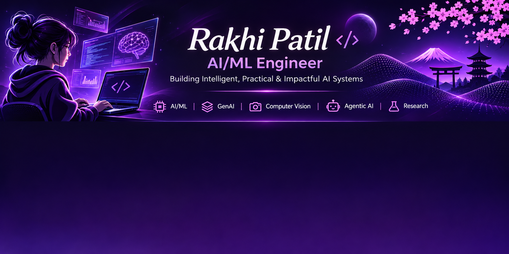

  

# Rakhi Patil

### AI/ML Engineer

Building Intelligent, Practical & Impactful AI Systems

---

## 👩‍💻 About Me

I'm an Artificial Intelligence & Machine Learning engineering student passionate about building intelligent systems, solving real-world problems, and exploring the frontiers of Generative AI, Agentic AI, and Computer Vision.

- 🔭 Building end-to-end AI/ML applications
- 🧠 Exploring RAG, LLMs, Agentic AI, and MCP
- 🔬 Interested in research, innovation, and intelligent automation
- 🚀 Always learning, experimenting, and creating

## 🛠️ Tech Stack

### Languages

### AI / Machine Learning

### Generative AI

### Development

---

## 🚀 Featured Projects

| Project | Description |
|---|---|
| 🚗 [Vehicle Copilot](https://github.com/Rakhi260/Agentic-Vehicle-Copilot.git) | RAG-powered intelligent vehicle assistant |
| 🧬 [Bio-Agentic Buffer](https://github.com/Rakhi260/Bio_Agentic_Buffer.git) | Agentic AI-powered wearable concept for emotional state detection and adaptive intelligent assistance |
| 🛍️ [Nishita Traders](https://github.com/Rakhi260/Nishita_Traders_website.git) | Web application for a jaggery trading business |
| 🛣️ [RoadVision AI](https://github.com/SnehaPatil28/RoadVision-AI.git) | YOLO-based road damage detection |
| 🤖 [Sunbeam Chatbot](https://github.com/Rakhi260/Sunbeam_Chatbot.git) | AI chatbot using Retrieval-Augmented Generation (RAG) |

Explore more at [My Repositories](https://github.com/Rakhi260?tab=repositories).

---

## 📊 GitHub Statistics

---

## 🌱 Currently Exploring

Agentic AI • MCP • AI Research • Game AI • Intelligent Systems

---

## 🤝 Connect With Me

- GitHub: [@Rakhi260](https://github.com/Rakhi260)
- LinkedIn: [rakhi260](www.linkedin.com/in/rakhi260)
- Email: rakhipatil2605@gmail.com

### Building • Learning • Innovating

